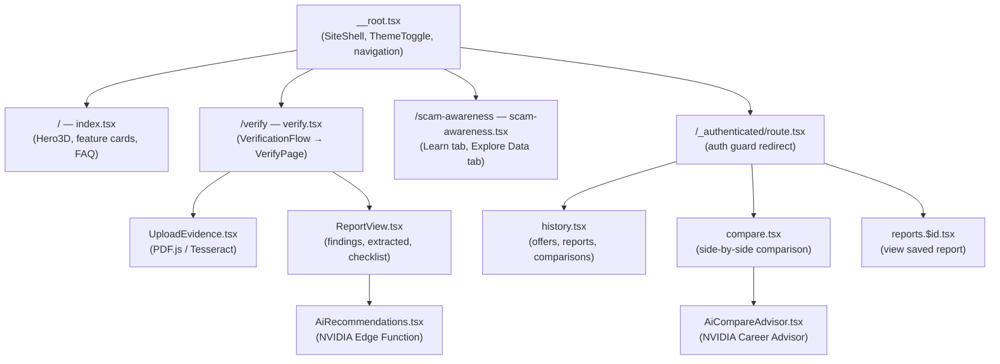
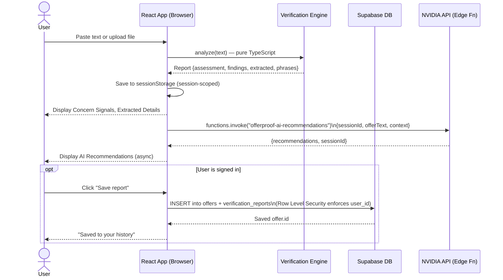

<div align="center">

# OfferProof

**Your next opportunity deserves verification.**

An explainable, privacy-first platform that helps students and job seekers verify job and internship offers before they reply, pay, or share personal information.

_Mentor Me Collective (MMC) BUILD, Fall 2026 · Google Cloud Launchpad Showcase · Team OfferProof_

[](https://www.typescriptlang.org/)
[](https://react.dev/)
[](https://tanstack.com/start)
[](https://tailwindcss.com/)
[](https://supabase.com/)
[](https://cloud.google.com/bigquery)
[](https://build.nvidia.com/)
[-brightgreen?logo=vitest&logoColor=white>)](./docs/09-security-and-testing.md)
[](https://sdgs.un.org/goals/goal9)

</div>

---

## Submission Links

| **Deliverable**                        | **Link**                                                                                         |
| -------------------------------------- | ------------------------------------------------------------------------------------------------ |
| Live demo / working product            | [Open OfferProof](https://offerproof-mmc.lovable.app/)                                           |
| Presentation deck (up to 8 slides)     | [Open Presentation](https://docs.google.com/presentation/d/112Ww9Kd2vptrHf4hlNABtG2Q0HgkXWEk/edit?usp=share_link&ouid=101117221453340941138&rtpof=true&sd=true)                                                                                       |
| Recorded walkthrough (up to 5 minutes) | [Open Video](https://drive.google.com/file/d/1Zg2yW70rpTAHxIBJ5B_wREHvc4SmhjLL/view?usp=sharing)                                                                                       |
| Written summary (up to 3 pages)        | [Open Summary](https://drive.google.com/file/d/1nPmlZ-WOsW3YOQVX87V0iwhnWd4HHbio/view?usp=share_link)                                                                                              |
| Team Findings (Google Drive)           | [Open Drive](https://drive.google.com/drive/folders/1Jdwh1QJlVpfTxtblkf1X1PwKmggzAcDd?usp=share_link) |
| Samples for testing                    | [Open Samples](https://drive.google.com/drive/folders/1ykIK6lx0tlwseCikQxy8Vnl90B-ajc_L?usp=share_link)                                           |

---

## 🎮 Demo Access

Explore OfferProof without creating an account.

- **Email:** demo@offerproof.com
- **Password:** OfferProof@2026

Alternatively, use the "**Explore Demo**" button
on the login page.

---

## Table of Contents

1. [Target Audience](#1-target-audience)
2. [Problem Statement](#2-problem-statement)
3. [UN Sustainable Development Goal](#3-un-sustainable-development-goal)
4. [Solution Overview](#4-solution-overview)
5. [Key Features](#5-key-features)
6. [User Journey](#6-user-journey)
7. [System Architecture](#7-system-architecture)
8. [Google Cloud Integration](#8-google-cloud-integration)
9. [NVIDIA Integration](#9-nvidia-integration)
10. [Fraud Detection Heuristics](#10-fraud-detection-heuristics)
11. [Technology Stack](#11-technology-stack)
12. [Setup and Run Instructions](#12-setup-and-run-instructions)
13. [Data Sources and Sample Data](#13-data-sources-and-sample-data)
14. [Testing and Quality Assurance](#14-testing-and-quality-assurance)
15. [Screenshots and Demo](#15-screenshots-and-demo)
16. [Privacy, Security, and Responsible Use](#16-privacy-security-and-responsible-use)
17. [Limitations and Future Scope](#17-limitations-and-future-scope)
18. [Team Credits and Individual Contributions](#18-team-credits-and-individual-contributions)
19. [Documentation Hub](#19-documentation-hub)
20. [License](#20-license)

---

## 1. Target Audience

OfferProof is built for people who receive an employment message and need a clear answer _before_ replying or sharing any information:

- **Students and recent graduates** applying for internships and first jobs, who are the most frequent targets of recruitment fraud.
- **Early-career engineers and career changers** evaluating unfamiliar companies and recruiters.
- **Remote workers** who cannot verify an employer in person.
- **Career services and placement cells** that want a transparent tool to recommend to students.

---

## 2. Problem Statement

Employment fraud has risen sharply and disproportionately targets people with little experience of hiring norms. Common tactics include:

- Requesting "refundable" registration, security, training, or equipment fees before joining.
- Impersonating recruiters through free webmail (for example `@gmail.com`) or look-alike domains (for example `acme-careers.net`).
- Demanding sensitive identity documents (Aadhaar, PAN, SSN) or credentials and one-time passcodes under manufactured urgency.
- Sending fake cheques and asking candidates to forward "excess funds" to a third party.

Job seekers typically hold a combination of evidence, such as a message, a screenshot, and a PDF offer letter, but have no simple, trustworthy way to check them. Many existing tools are black-box scores that give no reason for their verdict, which leaves users unsure whether to trust the result.

---

## 3. UN Sustainable Development Goal

**SDG 9: Industry, Innovation and Infrastructure.**

OfferProof applies cloud infrastructure and AI to strengthen the digital trust layer of the labor market. By making offer verification accessible, explainable, and free of charge to the job seeker, it helps protect early-career workers from financial loss and identity theft, and supports safer participation in the digital economy.

---

## 4. Solution Overview

OfferProof scans employment offers, appointment letters, and communication screenshots using **deterministic, explainable heuristics that run in the browser**. Every warning is tied to exact evidence highlighted in the offer text and paired with plain-language next steps. An AI advisory layer powered by NVIDIA adds contextual guidance, and Google Cloud BigQuery provides real-world threat analytics.

**Design principles**

- **Explainable:** every flag points to specific text and states why it matters, in plain words.
- **Privacy-first:** document parsing and rule evaluation happen locally; raw documents are not uploaded.
- **Deterministic core:** the verdict comes from fixed, testable rules. AI is used only for advisory guidance and does not decide the verdict.
- **Actionable:** results include verification steps, questions to ask the recruiter, and precautions.

---

## 5. Key Features

- **Client-side verification engine.** Evaluates text against 11 rule-based heuristics in milliseconds and classifies results as _Low Concern_, _Needs Review_, or _High Concern_.
- **In-browser document and OCR extraction.** Extracts text locally from PDFs (up to 20 pages, via PDF.js in a Web Worker) and from images or screenshots (via Tesseract.js in a Web Worker).
- **NVIDIA AI advisory guidance & intelligent extraction.** Generates structured _Verification Steps_, _Recruiter Questions_, and _Important Precautions_ through the `nvidia/nemotron-3.5-bolt-e4b` model, called from a Supabase Edge Function. Also powers intelligent document field extraction with verbatim evidence quotes.
- **AI Career Advisor (powered by NVIDIA Nemotron).** When comparing multiple job offers on `/compare`, candidates receive tailored fit recommendations, balanced pros and cons, salary and career growth insights, and recruiter questions based on candidate priorities and career goals.
- **Real threat analytics.** The Scam Awareness Centre queries Google BigQuery (`offerproof_analytics.job_postings`, about 17,880 records) so users can explore fraudulent versus legitimate postings with instant filtering.
- **Side-by-side offer comparison.** Authenticated users can compare offers side by side with AI-assisted career fit analysis and safety signals from each saved verification report.
- **Session isolation.** Strict `sessionStorage` scoping ensures concurrent users or tabs never overwrite each other's offer text or verification state.

---

## 6. User Journey

```text
1. Ingest (/verify)
   Paste offer text, or drop a PDF / screenshot.
   A local Web Worker extracts the text; nothing is sent over the network.
        |
        v
2. Analyze
   The deterministic engine runs 11 fraud rules: fees, sender-domain checks,
   urgency language, sensitive-information requests, and more.
        |
        v
3. Review results
   - Concern signals, each with highlighted evidence and a severity level
   - AI recommendations from NVIDIA: verification steps, recruiter questions, precautions
   - Extracted details: company, role, salary, location, contacts
   - Action guide and verification checklist
        |
        v
4. Compare and learn
   Compare multiple offers side by side, and explore real-world scam patterns
   in the Scam Awareness Centre.
```

---

## 7. System Architecture

# System Architecture

## Component Map



---

## Data Flow: Offer Verification



---

## 8. Google Cloud Integration

OfferProof integrates **Google Cloud BigQuery** as its threat-intelligence data layer to analyze historical job postings and help users identify patterns associated with fraudulent and legitimate job offers.

### Dataset and Data Analytics

- **Google Cloud Project:** `xenon-hub-514707-f9`
- **BigQuery Dataset:** `offerproof_analytics`
- **Table:** `job_postings`
- **Region:** `asia-south1`
- **Total Records:** 17,880 historical job postings
- **Legitimate Postings:** 17,014 (95.2%)
- **Fraudulent Postings:** 866 (4.84%)

The dataset powers the Job Postings Analytics interface, where users can explore historical job listings and compare legitimate postings with listings flagged as potentially fraudulent.

### Scam Awareness Centre

The BigQuery integration powers the **Scam Awareness Centre**, providing users with an interactive view of historical job-posting data.

Key features include:

- **Live Data Preview:** Displays job-posting analytics retrieved from the BigQuery dataset.
- **Search and Filtering:** Allows users to search postings by job title, company, industry, or description.
- **Fraud Classification Filters:** Enables users to view all postings or filter the results by legitimate and fraudulent classifications.
- **Detailed Job Listings:** Provides expandable job cards containing additional information about individual postings.
- **Dataset Statistics:** Displays record counts and the distribution of legitimate and flagged fraudulent postings.

These features help users understand common job-scam patterns and make more informed decisions when evaluating employment opportunities.

### Backend Integration and Authentication

The application uses a **Supabase Edge Function** named `offerproof-job-postings` as a secure intermediary between the frontend and Google Cloud BigQuery.

The request flow is:

1. The frontend requests job-posting data from the Supabase Edge Function.
2. The Edge Function authenticates with Google Cloud using a service account.
3. It uses a signed RS256 JWT exchanged through Google OAuth 2.0 to obtain authorization.
4. The function executes filtered BigQuery queries and returns the results to the application.
5. The frontend displays the retrieved records and updates the analytics interface according to the selected filters.

This architecture keeps Google Cloud authentication and database access on the server side rather than exposing them directly to the browser.

### Security and Secret Management

- **Server-Side Credentials:** The service-account credentials are stored as the Supabase Edge Function secret `GOOGLE_SERVICE_ACCOUNT_JSON`.
- **Credential Protection:** Sensitive Google Cloud credentials are not exposed to the frontend.
- **Controlled Data Access:** BigQuery queries are executed through the backend function instead of allowing direct browser access.
- **Filtered Queries:** The backend retrieves records according to the requested filters, supporting the application's search and browsing functionality.

### Role of BigQuery in OfferProof

BigQuery complements OfferProof's rule-based job-offer assessment system by providing a dataset of historical job postings for exploration and awareness. While the rule-based assessment evaluates warning signs in an offer, the Scam Awareness Centre allows users to investigate broader patterns across historical listings.

**Note:** Historical dataset classifications are intended to support awareness and investigation. A classification alone does not guarantee that a job posting is genuine or fraudulent.

---

## 9. NVIDIA Integration

OfferProof integrates **NVIDIA's hosted inference API** with the model **`nvidia/nemotron-3.5-bolt-e4b`** across two key features:

### 1. Single-Offer Verification Advisory & Intelligent Extraction

- **Access pattern:** the `offerproof-ai-recommendations` Supabase Edge Function (Deno) calls the NVIDIA chat-completion endpoint using the server-side `NVIDIA_API_KEY` secret.
- **Output:** structured guidance parsed into three sections: _Verification Steps_, _Recruiter Questions_, and _Important Precautions_. It also powers intelligent field extraction with exact supporting quotes verified against the original offer text.
- **Role of AI:** advisory only. Risk classification comes entirely from the deterministic rule engine so verdicts are reproducible and testable; AI output never overrides it.
- **Asynchronous & non-blocking:** AI guidance loads after rule-based results appear, so users get an immediate answer even if external inference is slow.

### 2. AI Career Advisor (Multi-Offer Comparison)

- **Component:** `src/components/compare/AiCompareAdvisor.tsx` on the `/compare` route.
- **Capabilities:** analyzes multiple job offers side by side based on candidate priorities and goals to generate:
  - **Best Career Fit**: Decisive recommendation on the overall strongest option.
  - **Comparison Summary & Pros/Cons**: Objective breakdown of each offer's trade-offs.
  - **Salary & Career Growth Insights**: Analysis of compensation, purchasing power, and growth trajectory.
  - **Missing Information & Recruiter Questions**: Unresolved ambiguities and questions for recruiters.
  - **Personalized Recommendations**: Concrete negotiation and decision-making steps.
- **Safety separation:** career fit is strictly decoupled from offer safety; AI models never declare an offer genuine or fraudulent.

See [`docs/06-ai-integration.md`](./docs/06-ai-integration.md) for full architecture and prompt designs.

---

## 10. Fraud Detection Heuristics

The core engine ([`src/lib/verify/engine.ts`](./src/lib/verify/engine.ts)) evaluates offers against 11 rules.

| ID                 | Finding                         |   Severity    | Points | Trigger                                                         |
| ------------------ | ------------------------------- | :-----------: | :----: | --------------------------------------------------------------- |
| `payment_request`  | Payment or fee requested        |     High      |   6    | Requests registration, security, or processing deposits         |
| `training_payment` | Training or equipment payment   |     High      |   6    | Requires candidates to pay for training, laptops, or badges     |
| `cheque_fraud`     | Potential cheque fraud          |     High      |   6    | Cheque deposit paired with an instruction to forward funds      |
| `sensitive_info`   | Sensitive information requested | High / Medium | 6 / 3  | OTPs, PINs, banking credentials (High); Aadhaar or PAN (Medium) |
| `personal_email`   | Recruiter uses free email       |    Medium     |   3    | Recruiter address uses Gmail, Yahoo, Outlook, Proton, etc.      |
| `domain_mismatch`  | Domain and company mismatch     |    Medium     |   3    | Sender domain does not match the extracted company name         |
| `suspicious_links` | Suspicious links                |    Medium     |   3    | URL shorteners, bare IP addresses, HTTP, or risky TLDs          |
| `unrealistic_pay`  | Unrealistic promises            |    Medium     |   3    | High daily income, "no interview needed", guaranteed money      |
| `urgency`          | Urgency or pressure language    | Medium / Low  | 3 / 1  | "Reply within 24 hours", "limited slots", and similar           |
| `missing_details`  | Missing key details             | Medium / Low  | 3 / 1  | Company, role, salary, location, or contacts are absent         |
| `multiple_domains` | Multiple sender domains         |      Low      |   1    | Emails come from conflicting root domains                       |

**Scoring.** Any High-severity signal, or a total of 8 or more points, yields **High Concern**. A total of 3 to 7 points yields **Needs Review**. A total of 0 to 2 points yields **Low Concern**.

Full rule specifications, including regex signatures and negation-clause handling, are in [`docs/05-fraud-detection.md`](./docs/05-fraud-detection.md).

---

## 11. Technology Stack

| Domain                  | Technology                        | Purpose                                                                                                |
| ----------------------- | --------------------------------- | ------------------------------------------------------------------------------------------------------ |
| Frontend framework      | React 19, TanStack Start          | Full-stack SSR and modern React architecture                                                           |
| Routing                 | TanStack Router                   | Type-safe, file-based routing                                                                          |
| Data fetching           | TanStack Query 5                  | Server-state caching and async mutations                                                               |
| Styling                 | Tailwind CSS v4, shadcn/ui        | Design tokens, light/dark theme, accessible components                                                 |
| 3D graphics             | Three.js, @react-three/fiber      | Interactive landing-page scene                                                                         |
| Document processing     | PDF.js, Tesseract.js              | In-browser PDF extraction and OCR via Web Workers                                                      |
| Backend and database    | Supabase (PostgreSQL)             | Managed database with owner-only Row Level Security                                                    |
| Serverless functions    | Supabase Edge Functions (Deno)    | Secure mediation of NVIDIA and BigQuery calls                                                          |
| Artificial intelligence | NVIDIA Nemotron 3.5               | `nvidia/nemotron-3.5-bolt-e4b` advisory recommendations, intelligent extraction, and AI Career Advisor |
| Threat intelligence     | Google Cloud BigQuery             | `offerproof_analytics.job_postings` analytics                                                          |
| Testing                 | Vitest, Testing Library           | 14 suites covering rules, session isolation, extraction, and UI                                        |
| Runtime and deployment  | Lovable-managed deployment        | Edge-compatible production build                                                                       |

---

## 12. Setup and Run Instructions

### Prerequisites

- Node.js 18.0.0 or later
- npm 9.0.0 or later (or Bun)
- A Supabase project (for authentication, database, and Edge Functions)
- An NVIDIA API key from [build.nvidia.com](https://build.nvidia.com/)
- A Google Cloud service account with BigQuery access (only needed for the Scam Awareness Centre)

### Installation

```bash
git clone <repository-url>
cd OfferProof-mmc
npm install
```

### Environment configuration

```bash
cp .env.example .env
```

Fill in your Supabase variables in `.env`, then set the Edge Function secrets:

```bash
supabase secrets set NVIDIA_API_KEY="nvapi-..."
supabase secrets set GOOGLE_SERVICE_ACCOUNT_JSON='{"type":"service_account",...}'
```

Apply database migrations and deploy the Edge Functions as described in [`docs/08-setup-and-deployment.md`](./docs/08-setup-and-deployment.md).

### Run locally

```bash
npm run dev
```

Open <http://localhost:3000>.

### Build for production

```bash
npm run build
```

The production build targets Cloudflare Workers through Nitro. Deployment details are in [`docs/08-setup-and-deployment.md`](./docs/08-setup-and-deployment.md).

> **Note for reviewers:** the core verification workflow (paste text, upload PDF or screenshot, view findings) runs entirely in the browser and works without NVIDIA or Google Cloud credentials. The AI recommendations panel and Scam Awareness Centre require the Edge Function secrets above.

---

## 13. Data Sources and Sample Data

- **Sample offers:** the MVP is validated against **20 fictional offers** covering text, screenshot, and PDF inputs, with a mix of legitimate and fraudulent examples. [Sample data](https://drive.google.com/drive/folders/1ykIK6lx0tlwseCikQxy8Vnl90B-ajc_L?usp=sharing)
- **Threat analytics dataset:** Google BigQuery table `offerproof_analytics.job_postings` (about 17,880 records). [Dataset](https://drive.google.com/file/d/1Ns5uC_LKnB-rD4yXVZPzXSvJjpxnvXcm/view?usp=share_link)

---

## 14. Testing and Quality Assurance

The project uses **Vitest** and **React Testing Library**; all 64 tests across 11 suites pass.

```bash
npm test               # run all automated tests
npm run test:watch     # interactive watch mode
npx tsc --noEmit       # strict TypeScript type-check
npm run build          # production build verification
```

Coverage areas include the fraud-detection rules (including negation handling), session isolation between users and tabs, and key UI behavior. The full test matrix is in [`docs/09-security-and-testing.md`](./docs/09-security-and-testing.md).

---

## 15. Screenshots and Demo

| View                                        | Screenshot         |
| ------------------------------------------- | ------------------ |
| Landing page                                | [Landing Page](https://github.com/user-attachments/assets/30fa1672-06ed-410b-ac48-16964bb7fbfc) |
| Ingestion workspace (`/verify`)             | [Verify](https://github.com/user-attachments/assets/c403784c-8487-41ce-9b62-504570049843) |
| Results dashboard with highlighted evidence | [Results](https://github.com/user-attachments/assets/e7cbb383-1af6-4a38-a6b2-aa7e1a4668ff) |
| AI recommendations panel                    | [AI Recommendation](https://github.com/user-attachments/assets/69f06aca-0e3d-4c53-9e42-06af9efdf163) |
| Offer comparison                            | [Offer Comparison](https://github.com/user-attachments/assets/6003a112-b99c-4211-bf9d-1e0eb3b8fc12) |
| Scam Awareness Centre                       | [Scam Awareness](https://github.com/user-attachments/assets/a05ab39d-ff03-4a78-88a0-0c0b98b6a071)   |
| BigQuery Dataset                            | [Big Query](https://github.com/user-attachments/assets/05cd8182-97f7-4ede-85a9-155882668005) |

**Recorded walkthrough (up to 5 minutes):** [Video](https://drive.google.com/file/d/1Zg2yW70rpTAHxIBJ5B_wREHvc4SmhjLL/view?usp=sharing) 

**Presentation deck (up to 8 slides):** [Presentation](https://github.com/user-attachments/files/35011109/OfferProof.pptx)


---

## 16. Privacy, Security, and Responsible Use

- **Local-first processing.** PDF parsing, OCR, and rule evaluation run in the browser. Raw documents are not uploaded.
- **Session isolation.** State is scoped per session so concurrent users never see or overwrite each other's data.
- **Row Level Security.** Saved reports, offers, and comparisons are owner-only, enforced in PostgreSQL by `auth.uid()`.
- **Secrets stay server-side.** NVIDIA and Google Cloud credentials live only in Edge Function secrets.
- **AI transparency.** The AI advisory call sends offer text to NVIDIA's inference API through the Edge Function. 
- **Not a guarantee.** OfferProof flags risk signals; it cannot prove an offer is genuine. Users should always verify employers through official channels.
- **Robots policy.** Private routes (`/history`, `/compare`, `/reports/`) are disallowed in [`public/robots.txt`](./public/robots.txt).

---

## 17. Limitations and Future Scope

**Current limitations**

- Rule-based detection can miss novel scam patterns and may flag unusual but legitimate offers.
- OCR accuracy depends on screenshot quality.
- PDF extraction is limited to 20 pages.
- The AI advisory layer depends on a third-party API and is not available offline.

**Next steps**

- Expand the rule set and add multilingual offer support.
- Add cross-document comparison and a review timeline to flag inconsistencies between a message, screenshot, and PDF.
- Integrate additional domain-reputation and company-registry checks.
- Partner with university placement cells for pilot deployments.

See [`docs/10-future-scope.md`](./docs/10-future-scope.md) and [`docs/roadmap.md`](./docs/roadmap.md) for the full roadmap.

---

## 18. Team Credits and Individual Contributions

**Team OfferProof** · Mentor Me Collective BUILD, Fall 2026 · SDG 9

| Member             | GitHub        | Track               | Individual contributions                                                               |
| ------------------ | ------------- | ------------------- | -------------------------------------------------------------------------------------- |
| **Dikshu Grover**  | [@Dikshu-Grover](https://github.com/Dikshu-Grover) | Cloud Engineering   | Delivery lead and product lead; developed the frontend and Supabase backend; integrated Google Cloud and NVIDIA technologies; implemented login/logout authentication and offer comparison functionality; led team coordination, meetings, task allocation, and documentation; prepared the OfferProof README; Tested offers on website; Made changes to the website after suggestions by team members; configured and managed the GitHub repository and uploaded the project codebase; recorded 5 minutes demo for OfferProof.     |
| **Janet Gichia** | [@Janet Gichia](https://github.com/janetgichia) | AI Cloud Leadership | Documentation and website testing; prepared and organised recruitment-offer samples; reviewed and tested the OfferProof website using fictional offers; captured and organised website screenshots; documented verification findings, concern signals and AI recommendations; evaluated downloadable PDF reports and identified improvement opportunities; contributed to project documentation and README updates. |
| **Mehzad Muqadas** | [@Mehzad Muqadas](https://github.com/MehzadMuqadas) | Cloud Cybersecurity | Audited and validated fraud verification rules; developed the testing spreadsheet and 20 test scenarios (S01–S20); documented fraud indicators; conducted evidence and permissions testing; prepared supporting documentation and screenshots; collaborated on the PowerPoint presentation and product showcase. |        |
| **Moses Otieno**   | [@Otieno27](https://github.com/Otieno27) | Cloud Cybersecurity | Evidence comparison module; permissions and evidence testing. Defined comparison fields, including company name, job title, salary, recruiter contact details, and joining date, to identify inconsistencies across submitted job offers. Developed five mismatch test scenarios covering discrepancies in key recruitment details and documented how these inconsistencies should be identified and presented. Evaluated the application's results against expected outcomes, documenting correctly identified warnings, unexpected results, and potential areas for improvement. |

**Acknowledgements:** Mentor Me Collective, the Google Cloud Launchpad program team, and NVIDIA for the inference platform and Nemotron models.

---

## 19. Documentation Hub

| Document                                                               | Description                                                      |
| ---------------------------------------------------------------------- | ---------------------------------------------------------------- |
| [`docs/01-overview.md`](./docs/01-overview.md)                         | Executive summary, problem statement, capabilities, and personas |
| [`docs/02-tech-stack.md`](./docs/02-tech-stack.md)                     | Frontend, backend, AI, and build dependencies                    |
| [`docs/03-architecture.md`](./docs/03-architecture.md)                 | Architecture diagrams, data flow, and security boundaries        |
| [`docs/04-workflow.md`](./docs/04-workflow.md)                         | Ingestion, parsing, verification, and comparison lifecycle       |
| [`docs/05-fraud-detection.md`](./docs/05-fraud-detection.md)           | Rule specifications, regex signatures, negation handling         |
| [`docs/06-ai-integration.md`](./docs/06-ai-integration.md)             | Edge function design, NVIDIA prompt design, JSON parsing         |
| [`docs/07-database-and-apis.md`](./docs/07-database-and-apis.md)       | Supabase schema and Row Level Security                           |
| [`docs/08-setup-and-deployment.md`](./docs/08-setup-and-deployment.md) | Installation, migrations, and Cloudflare deployment              |
| [`docs/09-security-and-testing.md`](./docs/09-security-and-testing.md) | Session isolation, data protection, and test matrix              |
| [`docs/10-future-scope.md`](./docs/10-future-scope.md)                 | Trade-offs and enhancement roadmap                               |
| [`docs/11-sitemap.md`](./docs/11-sitemap.md)                           | Route tree, access controls, and SEO specifications              |
| [`docs/roadmap.md`](./docs/roadmap.md)                                 | Phase tracker and milestones                                     |

---

## 20. License

This project is open-source and available under the terms of the [MIT License](LICENSE).

Copyright (c) 2026 Team OfferProof.
