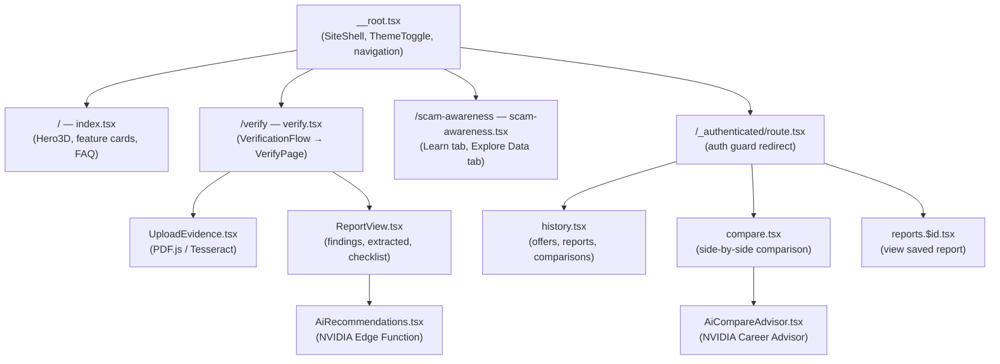
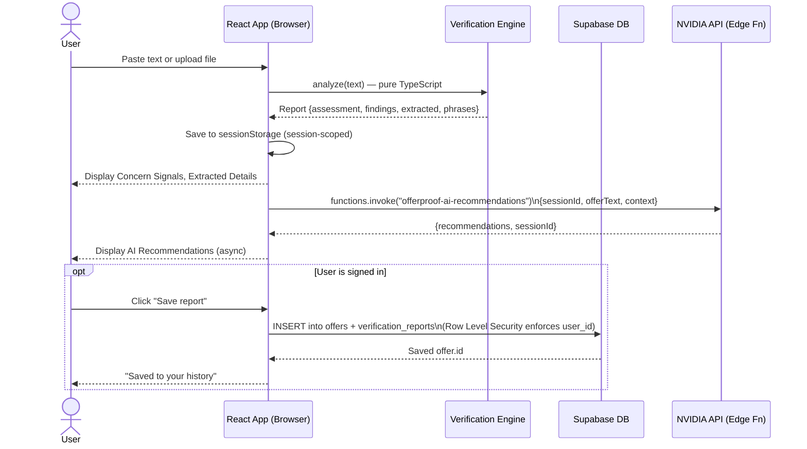

# System Architecture

## Component Map

---

## Data Flow: Offer Verification

---

## Security Boundary Summary

| Layer                        | Mechanism                                                                                             |
| ---------------------------- | ----------------------------------------------------------------------------------------------------- |
| **Browser ↔ Supabase DB**    | Publishable key + JWT Bearer token; Row Level Security on every table                                 |
| **Browser ↔ Edge Functions** | Supabase `functions.invoke()` (auto-attaches user JWT)                                                |
| **Edge Function ↔ NVIDIA**   | `NVIDIA_API_KEY` Supabase secret — never exposed to client                                            |
| **Edge Function ↔ BigQuery** | `GOOGLE_SERVICE_ACCOUNT_JSON` Supabase secret; short-lived OAuth2 access token minted at request time |
| **SSR server auth**          | `requireSupabaseAuth` middleware validates JWT before any server function runs                        |
