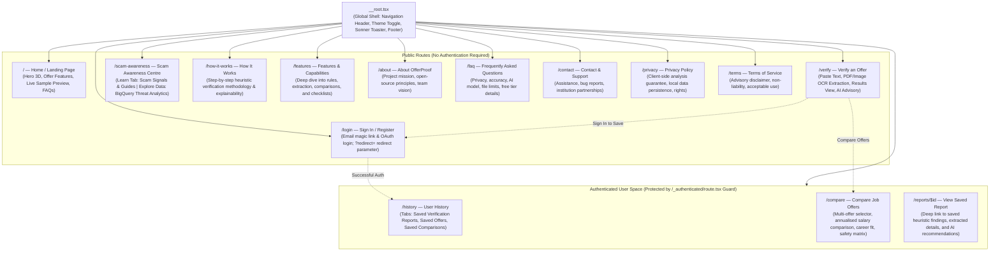

# Application Sitemap & Route Hierarchy

This document provides a comprehensive structural sitemap of the **OfferProof** application, outlining every public and authenticated route, visual hierarchy, user navigation flows, route guards, and SEO specifications.

---

## 1. Visual Site Hierarchy Diagram



---

## 2. Complete Route Catalog

| URL Path          | Route File                                  | Access        | Title                              | Description & Key Functionality                                                                                                                                                                        |
| ----------------- | ------------------------------------------- | ------------- | ---------------------------------- | ------------------------------------------------------------------------------------------------------------------------------------------------------------------------------------------------------ |
| `/`               | `src/routes/index.tsx`                      | Public        | Home — OfferProof                  | Landing page featuring Three.js 3D scene, hero value proposition, quick-verify CTA, feature highlights, and interactive FAQ accordion.                                                                 |
| `/verify`         | `src/routes/verify.tsx`                     | Public        | Verify an Offer — OfferProof       | The core verification workspace. Supports raw text input, PDF parsing (PDF.js), screenshot OCR (Tesseract.js), heuristic scanning, concern signals, extracted metadata, and NVIDIA AI recommendations. |
| `/scam-awareness` | `src/routes/scam-awareness.tsx`             | Public        | Scam Awareness Centre — OfferProof | Educational and analytics portal. Features two switchable tabs: **Learn** (scam indicators & advice) and **Explore Data** (live BigQuery job postings dataset preview with filters and summary stats). |
| `/how-it-works`   | `src/routes/how-it-works.tsx`               | Public        | How It Works — OfferProof          | Educational walkthrough explaining the local browser execution model, regex pattern matching, scoring tiers, and privacy boundaries.                                                                   |
| `/features`       | `src/routes/features.tsx`                   | Public        | Features — OfferProof              | In-depth breakdown of fee detection, domain verification, contact extraction, AI guidance, and comparison tables.                                                                                      |
| `/about`          | `src/routes/about.tsx`                      | Public        | About OfferProof                   | Mission statement, founding motivation, ethics of explainable AI, and community resources for job seekers.                                                                                             |
| `/faq`            | `src/routes/faq.tsx`                        | Public        | FAQ — OfferProof                   | Answers to technical and non-technical questions regarding pricing, privacy, supported file formats, and data retention.                                                                               |
| `/contact`        | `src/routes/contact.tsx`                    | Public        | Contact — OfferProof               | Contact form and feedback channels for users and educational placement cells.                                                                                                                          |
| `/privacy`        | `src/routes/privacy.tsx`                    | Public        | Privacy Policy — OfferProof        | Strict legal policy guaranteeing that offer files and texts remain local in the browser unless voluntarily saved.                                                                                      |
| `/terms`          | `src/routes/terms.tsx`                      | Public        | Terms of Service — OfferProof      | Terms of use outlining that verification results are heuristic signals rather than absolute legal or factual guarantees.                                                                               |
| `/login`          | `src/routes/login.tsx`                      | Public        | Sign In — OfferProof               | Authentication portal supporting Supabase passwordless magic-link email delivery and third-party OAuth.                                                                                                |
| `/history`        | `src/routes/_authenticated/history.tsx`     | **Protected** | History — OfferProof               | Account dashboard organizing saved records under three tabs: **Reports**, **Offers**, and **Comparisons** with delete actions.                                                                         |
| `/compare`        | `src/routes/_authenticated/compare.tsx`     | **Protected** | Compare Offers — OfferProof        | Side-by-side job offer comparison tool. Features an **AI Career Advisor powered by NVIDIA Nemotron** for personalized fit, pros/cons, and salary growth insights alongside heuristic safety warnings.  |
| `/reports/$id`    | `src/routes/_authenticated/reports.$id.tsx` | **Protected** | Saved Report — OfferProof          | Permanent permalink view for a previously verified and saved offer report.                                                                                                                             |

---

## 3. Route Guards & Navigation Logic

### Authentication Guard (`/_authenticated/route.tsx`)

```ts
// src/routes/_authenticated/route.tsx
export const Route = createFileRoute("/_authenticated")({
  beforeLoad: async ({ context, location }) => {
    const {
      data: { session },
    } = await supabase.auth.getSession();
    if (!session) {
      throw redirect({
        to: "/login",
        search: { redirect: location.href },
      });
    }
  },
});
```

- Any unauthenticated attempt to visit `/history`, `/compare`, or `/reports/:id` triggers an automatic redirect to `/login?redirect=...`.
- After successful sign-in, the user is redirected back to their intended destination via `safeRedirect()`.

### Guest Pending Queue Flow

1. A guest user verifies an offer on `/verify`.
2. The user clicks **"Save report"** or **"Compare Offers"**.
3. Since no session exists, the text is pushed to `localStorage` (`offerproof:pending-offers`) via `addPending(text)`.
4. The user is redirected to `/login?redirect=/history` or `/login?redirect=/compare`.
5. Upon signing in, `useImportPending()` automatically saves each pending offer to the database with its deterministic report, clears the local queue, and notifies the user with a toast.

---

## 4. Query Parameters & Dynamic Routes

| Route          | Parameter  | Type                    | Purpose                                                   | Example                                            |
| -------------- | ---------- | ----------------------- | --------------------------------------------------------- | -------------------------------------------------- |
| `/login`       | `redirect` | Search param            | Target URL to navigate to after authentication            | `/login?redirect=/compare`                         |
| `/compare`     | `id`       | Search param (optional) | Loads a pre-saved comparison by UUID from Supabase        | `/compare?id=550e8400-e29b-41d4-a716-446655440000` |
| `/reports/$id` | `$id`      | Path param (dynamic)    | Fetches and displays a specific saved verification report | `/reports/b1a77462-84f9-4d6d-8951-9e7987258411`    |

---

## 5. SEO & Search Engine Sitemap (`public/sitemap.xml`)

Search engine web crawlers are served an XML sitemap at `https://offerproof.lovable.app/sitemap.xml`.

### Indexing Policy (`public/robots.txt`)

- **Allowed:** All public marketing, educational, verification, and legal routes.
- **Disallowed (Noindex):** All private user dashboard routes (`/history`, `/compare`, `/reports/`) to preserve user confidentiality and prevent crawling empty authentication redirects.
