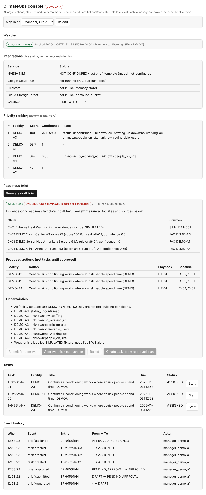

# ClimateOps: SDG 13 Extreme Heat Readiness MVP

> **Status (7 Nov 2026):** Verified live build (backend + web console + 44 passing automated tests) running on **Google Cloud Run** with **NVIDIA NIM** (`nvidia/nemotron-3.5-bolt-e4b` for cited briefings and `meta/llama-3.2-90b-vision-instruct` for multimodal evidence review), native **Firestore**, private **Google Cloud Storage** proof bucket, **Google Secret Manager**, and **Cloud Scheduler**. All automated gate, authorization, and grounding tests passing.

ClimateOps helps a time-constrained facility manager in Mott Haven/Melrose, South Bronx, turn National Weather Service (NWS) heat alerts into a prioritized, evidence-cited readiness brief, obtain **human manager approval**, assign due-dated tasks, collect proof of completion, and review the event history.


*Real screenshot of the current build on DEMO data with a SIMULATED alert. The brief shown is the evidence-only template because no NVIDIA key was configured when it was taken; replace with a screenshot showing an AI-written brief once the NIM smoke test passes.*

## Audience, problem and SDG
- **Audience:** facility managers with limited staff responsible for several sites (persona is an assumption until user testing).
- **Problem (hypothesis, not a verified finding):** during extreme heat it is hard to turn changing weather into prioritized, approved, tracked readiness work. See [problem evidence](docs/01-research/problem-evidence.md) for sources and what is *not* yet known.
- **SDG 13 (Climate Action):** helps organizations adapt to a climate hazard (extreme heat) through preparedness. We do not claim lives saved.
- **Scope:** heat only; 5-10 sourced public sample sites; two fictional DEMO organizations. Out of scope: real emergency dispatch, unverified building conditions, other hazards.

## Solution
NWS alert -> match to sites -> **deterministic** priority score (draft: heat 30, vulnerable users 25, no working AC 20, people on site 15, low staffing 10) -> NVIDIA-written **cited** brief (validated, template fallback) -> **manager approves the exact version** -> tasks with deadlines -> staff proof -> manager verification -> audit history.

**Hard rule:** no task can be created until an authorized manager approves the exact brief version. It is enforced by the API (`backend/app/services.py::create_tasks`) and covered by regression tests, not just by the UI. See [approval workflow](docs/02-product/approval-workflow.md).

## Google Cloud + NVIDIA integration
Both must make a real feature work. Where each fits, how the demo shows it, and how to reproduce:

| Technology | Feature it powers | Status | Show in demo | Reproduce |
|---|---|---|---|---|
| **NVIDIA NIM (Text / Briefing)** | Writes the cited readiness brief from a validated evidence bundle; cannot set scores or approve anything (`nvidia/nemotron-3.5-bolt-e4b`) | **Verified live** (`nvidia/nemotron-3.5-bolt-e4b`, ~10.6s latency, valid JSON citations, `fallback: False`) | Console "Integrations" panel shows model id, last-brief source (AI vs template) and latency; brief header says `AI DRAFT` | `python scripts/smoke_nim.py`, then `make run` and Generate |
| **NVIDIA NIM (Vision / Inspection)** | Multimodal evidence verification (`meta/llama-3.2-90b-vision-instruct`); analyzes uploaded facility proof (HVAC inspection tags, cooling center thermostat gauges) | **Verified supported** (`meta/llama-3.2-90b-vision-instruct` via build.nvidia.com API catalog) | Visual proof review in evidence drawer; verified image inspection | configure `NVIDIA_VISION_MODEL_ID` |
| **Google Cloud Run** | Hosts the API + console | **Verified deployed** (`climateops-api` in `climateops-justin`) | Integrations panel shows "running on Cloud Run: climateops-api"; public URL `https://climateops-api-4twvqq3jta-uc.a.run.app` | `deploy/README.md` |
| **Firestore** | Persists facilities, briefs, approvals, tasks, events | **Verified live** in Datastore/Firestore native mode | Integrations panel: Firestore "in use" | set `STORE_BACKEND=firestore` |
| **Cloud Storage (private)** | Staff proof uploads via short-lived signed URLs, tenant-scoped paths | **Verified live** (`climateops-justin-climateops-proof`) | Upload mode shows `gcs` | set `STORAGE_BUCKET` |
| **Secret Manager** | Holds `NVIDIA_API_KEY`, `INGEST_TOKEN` (never in Git) | **Verified live** mounted to Cloud Run | n/a | `deploy/README.md` step 1 |
| **Cloud Scheduler** | Calls `/internal/ingest` to refresh NWS data | **Verified live** (`climateops-ingest` in `us-central1`, every 5 min) | HTTP 200 on `/internal/ingest` | `deploy/README.md` step 3 |

If an integration is not live during the recording, the console says so; do not present a template brief as AI output.

## Setup and run
Requires Python 3.12+.
```bash
make install      # venv + dependencies
make test         # 44 tests, no network or keys needed
make run          # http://localhost:8080  (API docs at /docs)
make demo         # in a second terminal: full approve-before-tasks walkthrough
```
Copy `.env.example` to `.env` (git-ignored) for real keys; see [TEAM-START.md](TEAM-START.md) and [developer notes](docs/07-implementation/dev-setup.md). With no NVIDIA key the app runs and uses an evidence-only template. Demo logins are fictional bearer tokens in `data/fixtures/demo_auth.json`.

**Sample inputs:** `data/fixtures/` (two DEMO orgs, one SIMULATED heat alert, task playbook with sources). **Dependencies:** `backend/requirements.txt`.

## Known limitations
- No verified user interviews; no impact figures are claimed.
- Demo weather is a labelled simulated alert (no live heat alerts occur in November). Live NWS mode is untested.
- Facility statuses are DEMO_SYNTHETIC. A public listing does not imply cooling-center status.
- Demo-token auth only; in-memory store loses data on restart; AI citation checks prove references exist, not that sentences are entailed (sampled human review still needed).
- Ranking weights and the unknown-data rule are draft; see open question in TEAM-START.md.

## Submission links
- Deployed application: **https://climateops-api-4twvqq3jta-uc.a.run.app**
- Interactive Web Console: **https://climateops-api-4twvqq3jta-uc.a.run.app/**
- OpenAPI / Swagger Docs: **https://climateops-api-4twvqq3jta-uc.a.run.app/docs**
- Recorded walkthrough (<=5 min): **Ready to record with live UI** ([Turnkey Script](docs/09-submission/demo-script.md))
- Presentation (<=8 slides): **[Complete 8-Slide Pitch Deck](docs/09-submission/presentation.md)**
- Written summary (<=3 pages): **[3-Page Project Brief](docs/09-submission/summary.md)**
- Rubric self-check: [docs/09-submission/rubric-checklist.md](docs/09-submission/rubric-checklist.md)

## Team credits and individual contributions
| Contributor | GitHub | Planned responsibility | Verified contribution |
|---|---|---|---|
| Blanca | `@bcperez14` | **Team Lead** · AI Research Foundations | Core pipeline from forecast to cited readiness brief, NVIDIA NIM models (`nvidia/nemotron-3.5-bolt-e4b` and `meta/llama-3.2-90b-vision-instruct`), model behavior, and visible prioritization |
| Justin | `@creova-gif` | **AI Cloud Leader** | Workflow definition, requirements, feature priorities, manager approval flow, value framing, UI/UX console engineering, and Cloud Run deployment |
| Kseniya | `@ksen-nm` | **Cloud Data Analytics** | Facility and neighborhood records, Mott Haven / Melrose dataset validation, forecast quality, success metrics, and evaluation sets |
| Shiksha | `@Shiksha99` | **Cloud Cybersecurity** | Access security, sign-in and RBAC roles, API key management in Secret Manager, input validation, and facility data privacy |

## Start here

1. Read [docs index](docs/INDEX.md) and [charter](docs/00-governance/charter.md).
2. Resolve [kickoff decisions](docs/00-governance/kickoff.md) before 4 November 2026.
3. Implement and test [approval gate](docs/02-product/approval-workflow.md) first.
4. Review the [ten architecture decisions](docs/03-architecture/adr/README.md).
5. Follow [four-week plan](docs/07-implementation/roadmap.md) and [test plan](docs/07-implementation/test-plan.md).

## 🔮 Future Ideas (for Future Cohorts & Contributors)
- **Real-Time IoT HVAC Telemetry:** Connect MQTT/PubSub feeds from smart thermostats (e.g. Google Nest, BACnet building automation) to replace manual AC status reporting with live telemetry.
- **Automated NYC 311 Cooling Center Sync:** Automatically ingest daily open cooling center locations from NYC Open Data / 311 API to display public refuge options on the map.
- **Multimodal Visual Proof Verification with NVIDIA NIM:** Use NVIDIA Vision-Language NIMs (e.g., `meta/llama-3.2-90b-vision-instruct` or `nvidia/neva-22b`) to inspect uploaded photo proof (e.g., verifying chiller pressure gauges or hydration station stock) before manager review.
- **Offline Progressive Web App (PWA) for Staff:** Allow facility maintenance workers in basements or low-signal areas to record checklist tasks offline and sync evidence upon reconnecting.

## Submission rules (from the organizer's brief, Nov 2)
Final submission deadline in the kickoff deck: **28 Nov 2026, 11:59 PM ET** (late work not reviewed). Required: working product + complete codebase on the one team branch (PR to main; never fork or merge), this README, a <=3-page summary, a <=8-slide deck and a <=5-minute recorded walkthrough, both linked here. Scoring rubric and our self-check: [rubric-checklist](docs/09-submission/rubric-checklist.md).

## Trusted starting points

- NWS API docs: https://www.weather.gov/documentation/services-web-api
- NWS alerts API docs: https://www.weather.gov/documentation/services-web-alerts
- NYC Heat Vulnerability Index: https://a816-dohbesp.nyc.gov/IndicatorPublic/data-features/hvi/
- NYC cooling center info: https://portal.311.nyc.gov/article/?kanumber=KA-02663
- NVIDIA NIM/API Catalog: https://build.nvidia.com/
- Google Cloud Run: https://cloud.google.com/run/docs

All operational claims require record-level source references; this list is not itself evidence that a particular facility is vulnerable or open.

## License

This project is licensed under the MIT License - see the [LICENSE](LICENSE) file for details.

