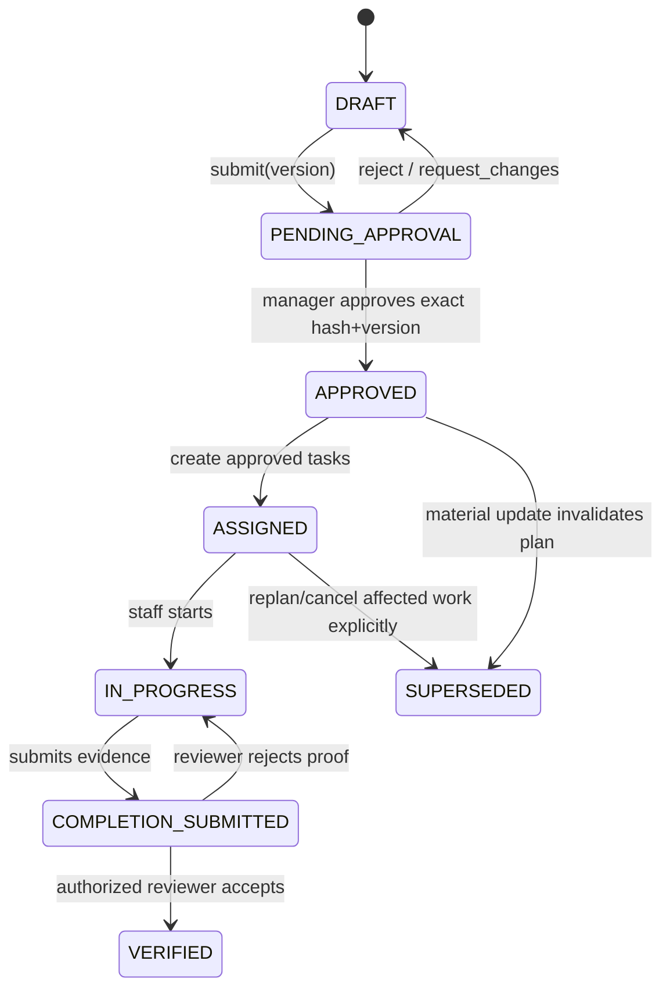

# Approval-first workflow: executable contract

**Owners:** Justin (requirements), Blanca (implementation), Shiksha (security). **Status:** proposed, critical gate.

## State machine

## Invariants

- `Task.create()` is denied unless brief status `APPROVED`, approval actor has manager role, tenant IDs match, and `approval.version == brief.version == task.approved_version` **plus approval is active and bound to the plan**.
- Brief content is frozen at approval with content hash. A changed brief creates a new version; an earlier approval cannot authorize that version.
- A rejection, revocation, superseding weather event or explicit cancellation cannot automatically create tasks.
- Idempotency key prevents retry-induced duplicate tasks.
- All state changes and corresponding audit events are committed together when supported; failures roll back.
- Reviewer identity and timestamp required for proof verification. Evidence submission alone is not verified completion.

## Transition examples

| Action | Allowed role/state | Invalid behavior |
|---|---|---|
| Submit draft | manager or authorized editor, `DRAFT` | cannot submit empty source bundle |
| Approve v3 | manager, `PENDING_APPROVAL`, same tenant | staff cannot approve; v2 approval not valid |
| Create tasks | authenticated dispatcher, `APPROVED` v3 | direct task API before approval returns 409/403 |
| Submit proof | assigned demo staff, `IN_PROGRESS` | different tenant rejected |
| Verify | manager or authorized reviewer | cannot verify own submission when separation configured |

## Minimal audit fields

`event_id, tenant_id, entity_id, event_type, previous_state, new_state, actor_role, occurred_at, request_id, content_version, source_reference`.

## Security regression suite

- Staff tries approval → 403.
- Manager of demo tenant B approves tenant A plan → 403.
- Task creation in `DRAFT` or `PENDING_APPROVAL` → rejected.
- Edited plan after approval → requires new approval.
- Duplicate callback/retry → creates one task set.
- Evidence for another tenant → 403.
- Concurrent approval/revision: exactly one valid version wins.
