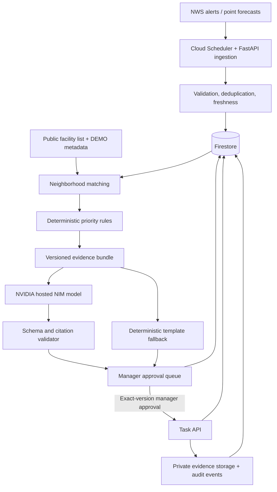

# System architecture and component boundaries

**Owner:** Blanca; product acceptance: Justin; security review: Shiksha.

## Trust boundaries

1. External NWS response is untrusted until parsed, schema-checked and timestamped.
2. Synthetic tenant readiness inputs are explicit DEMO assumptions, not external facts.
3. NVIDIA text is untrusted output; use constrained JSON schema and source consistency validation.
4. Approval is a privileged server-side action with tenant and version checks.
5. Completion uploads are untrusted files stored privately, type-limited and never executed.

## Proposed services

- `weather_ingestion`: scheduled secured NWS calls, retries and source snapshot recording.
- `facility_matching`: geospatial association to applicable NWS area/point metadata; explain method and boundaries.
- `priority_engine`: pure deterministic function with recorded version.
- `brief_generation`: evidence bundle → NIM → schema/claim validation → draft; fallback if unsupported.
- `approval_workflow`: manager-authorization checks and atomic status transition.
- `task_management`: due-dated approved work and evidence review.

## Google/NVIDIA responsibility split

Google Cloud Run hosts the API and management workflow. Cloud Scheduler performs scheduled updates. Firestore persists structured state; Cloud Storage stores private sample proof. NVIDIA model transforms validated evidence into concise cited readiness text. Demonstrate real network integration and logs without revealing tokens, personal data or privileged infrastructure identifiers.

## Failure behavior

- No NWS connectivity: preserve last response only as historical, show stale banner; avoid novel current claims.
- NIM unavailable: render deterministic evidence template, display model-unavailable status.
- Approval race: compare-and-set version and append audit event atomically.
- Upload failure: task remains open; retry with idempotency key.
- Tenant auth failure: reject and emit security-safe audit event.
