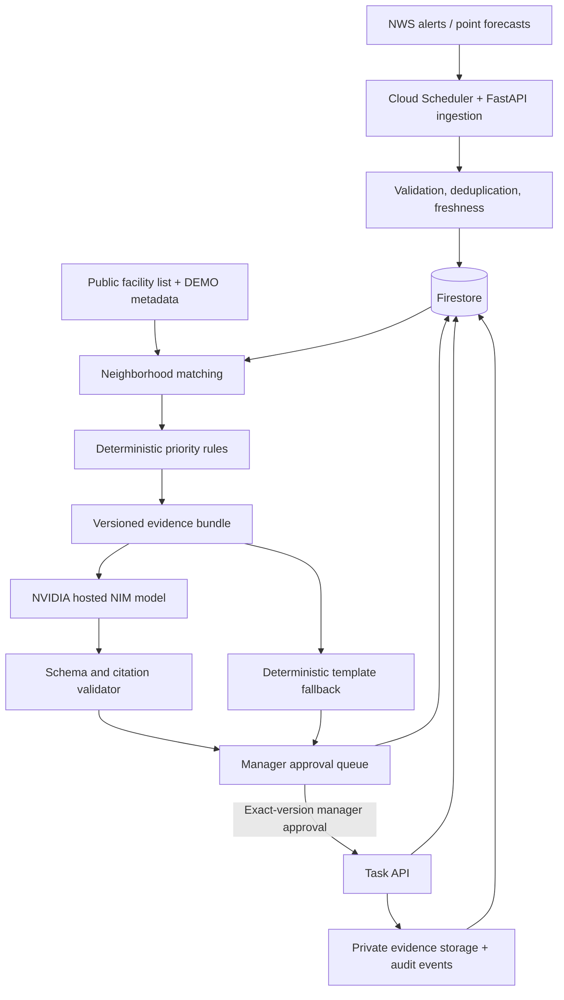

# System architecture and component boundaries

**Owner:** Blanca; product acceptance: Justin; security review: Shiksha.

## Trust boundaries

1. External NWS response is untrusted until parsed, schema-checked and timestamped.
2. Synthetic tenant readiness inputs are explicit DEMO assumptions, not external facts.
3. NVIDIA text is untrusted output; use constrained JSON schema and source consistency validation.
4. Approval is a privileged server-side action with tenant and version checks.
5. Completion uploads are untrusted files stored privately, type-limited and never executed.

## Proposed services

- `weather_ingestion`: scheduled secured NWS calls, retries and source snapshot recording.
- `facility_matching`: geospatial association to applicable NWS area/point metadata; explain method and boundaries.
- `priority_engine`: pure deterministic function with recorded version.
- `brief_generation`: evidence bundle → NIM → schema/claim validation → draft; fallback if unsupported.
- `approval_workflow`: manager-authorization checks and atomic status transition.
- `task_management`: due-dated approved work and evidence review.

## Google/NVIDIA responsibility split

Google Cloud Run hosts the API and management workflow. Cloud Scheduler performs scheduled updates. Firestore persists structured state; Cloud Storage stores private sample proof. NVIDIA model transforms validated evidence into concise cited readiness text. Demonstrate real network integration and logs without revealing tokens, personal data or privileged infrastructure identifiers.

## Failure behavior

- No NWS connectivity: preserve last response only as historical, show stale banner; avoid novel current claims.
- NIM unavailable: render deterministic evidence template, display model-unavailable status.
- Approval race: compare-and-set version and append audit event atomically.
- Upload failure: task remains open; retry with idempotency key.
- Tenant auth failure: reject and emit security-safe audit event.

## Presentation & Client Interfaces

### 1. Operations Command Center (`web/index.html`)
The central dashboard is served directly from Google Cloud Run (`/`) and connects via REST to `/api/v1`. It includes:
- **Climate Hazard Simulator & Scenario Controller**: Allows operators and evaluators to test resilience across diverse weather regimes (Extreme Heat Wave 🔥 at 104°F, Severe Winter Freeze ❄️ at 16°F Code Blue, and Moderate Baseline 🍃 at 72°F, plus Live NWS Feed).
- **Dynamic KPI & Forecast Replay**: Hourly forecast curve adjusts dynamically to hazard type, displaying peak danger thresholds and spatial risk mapping across South Bronx Community District 1.
- **Human Approval Gate (ADR-001)**: Mandatory manager sign-off on AI-synthesized readiness briefs before task dispatch.
- **Truthful Provenance & Data Freshness**: Clear visual badges (`PUBLIC_VERIFIED` vs `DEMO_SYNTHETIC`, `[DEMO/SIMULATED]` replay markers).

### 2. Field Companion App (`mobile/`)
A cross-platform React Native / Expo application built for facility managers, shelter coordinators, and field staff:
- **Direct Cloud Run Backend Integration**: Communicates with `https://climateops-api-4twvqq3jta-uc.a.run.app/api/v1` via scoped Bearer authentication (`demo-manager-a`).
- **On-Site Telemetry & Status Reporting**: Enables field staff to submit live HVAC/boiler operational status, real-time occupancy counts, and staffing coverage.
- **Evidence & Proof Uploads**: Connects to the Cloud Run GCS signed-URL endpoint (`/tasks/{tid}/evidence/upload-url`) to capture and store tamper-evident timestamped photos for task verification.
- **Offline Resilience**: Automatically falls back to localized South Bronx facility fixtures and cached rankings when cellular connectivity is degraded during extreme weather events.
