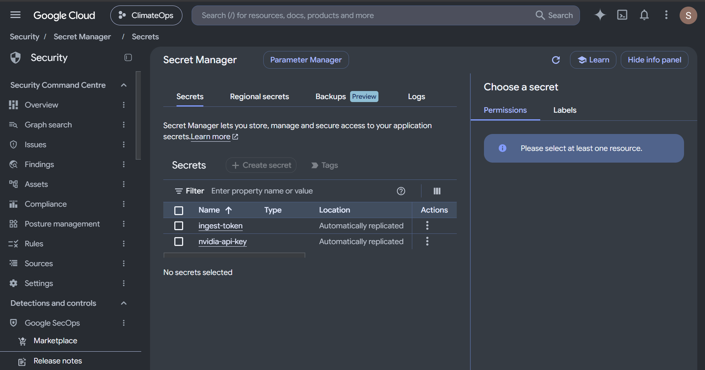
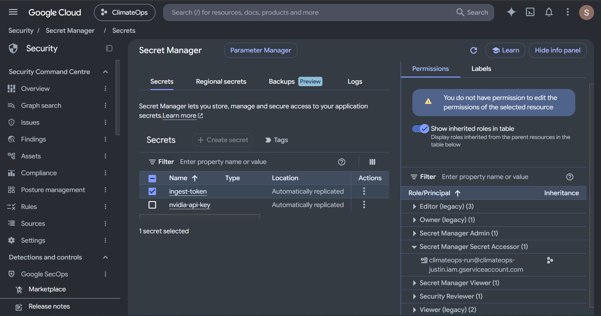
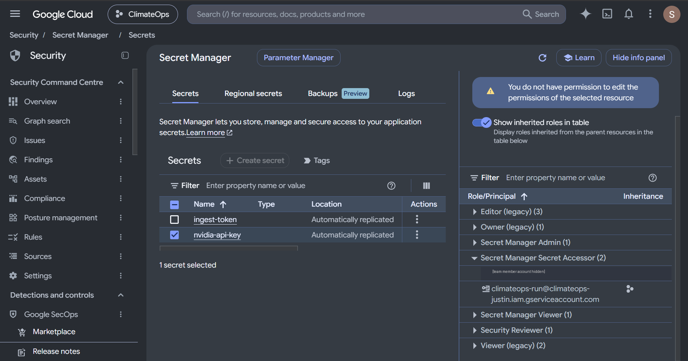
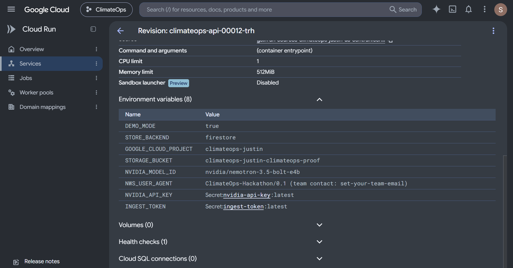
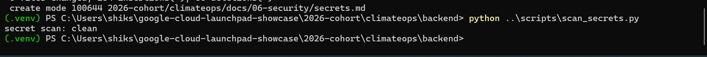

# API keys and secrets (Secret Manager)

**Owner:** Shiksha (`@Shiksha99`) · **Status:** verified live in Google Cloud project `climateops-justin` on 22 Nov 2026 (screenshots below).

## What the secrets are

| Secret | Used for | Where it lives | Who can read it |
|---|---|---|---|
| `nvidia-api-key` | Calls NVIDIA NIM to write briefs | Google Secret Manager | Cloud Run service account `climateops-run@climateops-justin.iam.gserviceaccount.com`, plus one team member account used during setup (see findings) |
| `ingest-token` | Lets Cloud Scheduler call `/internal/ingest` | Google Secret Manager | Cloud Run service account `climateops-run` only; value also set in the Scheduler job header |

Nothing else in the app is secret. The demo sign-in tokens are public fixtures by design.

## How a key reaches the app

1. The key is created by piping it into Secret Manager from a shell, so it is never written to a file (`deploy/README.md` step 1).
2. Cloud Run mounts it as an environment variable with `--set-secrets NVIDIA_API_KEY=nvidia-api-key:latest,INGEST_TOKEN=ingest-token:latest`.
3. The app reads secrets in one place only, `backend/app/config.py`, and never logs them.
4. The browser never receives a key: all NVIDIA calls happen on the server. `/api/v1/integrations/status` reports only whether a key is present (true/false), never the value.

## How we keep keys out of GitHub

- `.env` and other env files, `*.pem`, `*.key` and service-account JSON files are in `.gitignore`.
- `.env.example` contains placeholders only (`SET_VIA_SECRET_MANAGER_NOT_GIT`).
- `scripts/scan_secrets.py` looks for NVIDIA, Google, AWS, GitHub and Slack keys, private key blocks, service account files and assigned secrets. Run it with `make scan`, and install it as a pre-commit hook with `make hooks`. Last run on this branch: **clean**.

## Rotation (how to change a key)

```bash
# NVIDIA key: add a new version, redeploy so Cloud Run picks up :latest, then revoke the old key at build.nvidia.com
printf '%s' "$NEW_NVIDIA_API_KEY" | gcloud secrets versions add nvidia-api-key --data-file=-
gcloud run services update climateops-api --region $REGION --update-secrets NVIDIA_API_KEY=nvidia-api-key:latest
gcloud secrets versions disable <OLD_VERSION> --secret=nvidia-api-key

# Ingest token: new random value, redeploy, then update the Scheduler header
openssl rand -hex 24 | tr -d '\n' | gcloud secrets versions add ingest-token --data-file=-
```

Rotate immediately if a key is ever pasted into chat, a screenshot, a commit or a log.

## Verified in Google Cloud (22 Nov 2026)

| Check | Result | Evidence |
|---|---|---|
| Both secrets exist in Secret Manager | `ingest-token`, `nvidia-api-key` (automatically replicated) |  |
| Cloud Run uses a dedicated service account, not the Compute Engine default | `climateops-run@climateops-justin.iam.gserviceaccount.com` | permissions screenshots below |
| Who can read `ingest-token` | Only the `climateops-run` service account |  |
| Who can read `nvidia-api-key` | `climateops-run` service account and one team member account (hidden in screenshot) |  |
| Cloud Run references secrets instead of pasted values | `NVIDIA_API_KEY = Secret:nvidia-api-key:latest`, `INGEST_TOKEN = Secret:ingest-token:latest` on revision `climateops-api-00012-trh` |  |
| No keys in the repository | `secret scan: clean` |  |

Values were never opened or displayed while collecting this evidence.

## Findings and recommendations

1. **Remove the personal account's Secret Accessor role on `nvidia-api-key`** once setup is finished, so only the app's service account can read the key (least privilege). Requires a project owner; the security reviewer account has view-only access.
2. **Set a real contact in `NWS_USER_AGENT`.** Cloud Run still has the placeholder `set-your-team-email`; the National Weather Service asks API users to include a contact.
3. Grant Cloud Storage access on the proof bucket only (`roles/storage.objectCreator` plus `objectViewer`), not `storage.objectAdmin` project-wide.
4. Have Cloud Scheduler authenticate with an OIDC token instead of a static header, so the token value is not stored in the job config.
5. Set a Billing budget alert so a polling or generation loop cannot run up costs.
